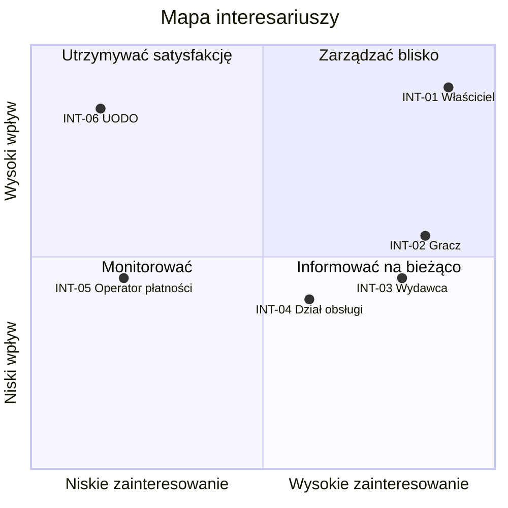

# 01. Wizja i zakres systemu

## 1.1. Opis problemu

| | |
|---|---|
| **Problem** | Rynek cyfrowej dystrybucji gier komputerowych jest zdominowany przez jedną platformę (Steam), której rozbudowany interfejs utrudnia nowym Graczom znalezienie i kupienie Gry, a małym Wydawcom dotarcie do Graczy. |
| **dotyczy** | Graczy (zwłaszcza nowych i amatorskich), małych i niezależnych Wydawców oraz pracowników obsługi, którzy rozpatrują Reklamacje. |
| **skutkiem jest** | Gracze tracą czas na szukanie Gier i rezygnują z zakupu, mali Wydawcy giną w ogromnej ofercie, a brak konkurencji ogranicza wybór usług na rynku. |
| **dobre rozwiązanie** | Gracz szybko znajduje i kupuje Grę i ma wszystkie Gry w jednej Bibliotece gier, Wydawca samodzielnie publikuje Grę i ustala jej cenę, a Reklamacje są rozpatrywane w jednym miejscu. |

## 1.2. Cel biznesowy i mierniki sukcesu

| ID | Cel | Miernik | Wartość docelowa |
|---|---|---|---|
| CEL-01 | Skrócić czas, w którym nowy Gracz znajduje i kupuje Grę | Mediana czasu od pierwszego wyszukania Gry do opłacenia Zamówienia (test z 10 nowymi Graczami) | ≤ 3 min w teście przed uruchomieniem platformy |
| CEL-02 | Umożliwić małym Wydawcom samodzielną publikację Gier | Liczba Gier o Statusie gry OPUBLIKOWANA dodanych przez niezależnych Wydawców | ≥ 20 Gier w ciągu 6 miesięcy od uruchomienia |
| CEL-03 | Rozpatrywać Reklamacje szybko i w jednym miejscu | Odsetek Reklamacji o Statusie reklamacji UZNANA lub ODRZUCONA w ciągu 3 dni roboczych od złożenia | ≥ 90% Reklamacji w każdym miesiącu od uruchomienia |

## 1.3. Interesariusze

| ID | Interesariusz | Opis / rola | Oczekiwania wobec systemu | Wpływ (W/Ś/N) | Zainteresowanie (W/Ś/N) |
|---|---|---|---|---|---|
| INT-01 | Właściciel platformy (klient) | Firma zamawiająca system i prowadząca platformę WSPA GIER | Konkurencyjna platforma, przychód ze sprzedaży Gier, rosnąca liczba Graczy i Wydawców | W | W |
| INT-02 | Gracz | Osoba kupująca Gry i korzystająca z Biblioteki gier | Szybkie znalezienie i zakup Gry, prosty interfejs, bezpieczna Płatność, łatwe pobieranie | Ś | W |
| INT-03 | Wydawca | Duże studio, małe lub niezależne studio publikujące Gry | Samodzielna publikacja Gry i Wersji gry, kontrola cen i Promocji, dotarcie do Graczy | Ś | W |
| INT-04 | Dział obsługi (Agent wsparcia, Administrator) | Pracownicy platformy rozpatrujący Reklamacje i moderujący treści | Pełna historia Zamówień Gracza w jednym miejscu, szybkie rozpatrywanie Reklamacji i Zgłoszeń naruszenia | Ś | Ś |
| INT-05 | Operator płatności | Zewnętrzna firma autoryzująca Płatności i wykonująca Zwroty | Poprawne i bezpieczne żądania Płatności i Zwrotów zgodne z jego API | Ś | N |
| INT-06 | Prezes UODO | Organ nadzorczy w zakresie ochrony danych osobowych | Przetwarzanie danych Graczy i Wydawców zgodnie z RODO | W | N |

INT-05 i INT-06 nie są użytkownikami systemu.

### Mapa interesariuszy

## 1.4. Użytkownicy systemu (aktorzy)

| Aktor | Kim jest | Jak często korzysta | Kompetencje cyfrowe |
|---|---|---|---|
| Gracz | Osoba z Kontem, która przegląda Katalog gier, kupuje Gry, pobiera je z Biblioteki gier, wystawia Oceny i Recenzje oraz składa Reklamacje | | |
| Wydawca | Studio lub osoba z Kontem deweloperskim, która publikuje Gry, wgrywa Wersje gry i ustala ceny oraz Promocje | | |
| Agent wsparcia | Pracownik działu obsługi, który rozpatruje Reklamacje i zleca Zwroty | | |
| Administrator | Pracownik platformy z najwyższymi uprawnieniami: weryfikuje Gry, moderuje Recenzje, rozpatruje Zgłoszenia naruszenia, zarządza Kontami | | |

System płatności jest systemem zewnętrznym (sekcja 1.6), a nie użytkownikiem.

## 1.5. Zakres systemu

### W zakresie (MVP — realizacja w cz. 2)

- Konto: rejestracja, logowanie, wylogowanie, zmiana hasła, usunięcie Konta, profil Gracza
- Katalog gier: przeglądanie, wyszukiwanie po nazwie, filtrowanie po Gatunku i cenie, strona Gry
- Zamówienie i Płatność: zakup Gry przez zewnętrzny System płatności, nadanie Licencji
- Biblioteka gier: lista Gier Gracza, pobieranie aktualnej Wersji gry, ukrycie Gry
- Oceny i Recenzje Gier wystawiane przez Graczy z Licencją
- Panel Wydawcy: Konto deweloperskie, dodawanie Gry i Wersji gry, ustalanie ceny i Promocji, lista własnych Gier
- Reklamacje i Zwroty: złożenie Reklamacji, rozpatrzenie przez Agenta wsparcia, Zwrot przez System płatności
- Moderacja: weryfikacja Gier przed publikacją, usuwanie Recenzji, Zgłoszenia naruszenia, blokowanie Kont (Administrator)

### Poza zakresem (świadomie wyłączone)

- Własny program do uruchamiania Gier (launcher) i automatyczne pobieranie nowych Wersji gry na urządzenie Gracza
- Funkcje społecznościowe poza Ocenami i Recenzjami: znajomi, czat, grupy, fora
- Natywna aplikacja mobilna (platforma działa w przeglądarce, także na telefonie)
- Handel przedmiotami z Gier między Graczami i portfel środków na platformie
- Wiele walut i języków (MVP: PLN, język polski)

### Możliwe rozszerzenia (po MVP)

- Lista życzeń i powiadomienia o Promocjach
- Rekomendacje Gier dopasowane do Gracza
- Własne kolekcje i ulubione Gry w Bibliotece gier
- Osiągnięcia i statystyki czasu gry
- Logowanie przez konta zewnętrzne (Google)
- Wersja anglojęzyczna i inne waluty

## 1.6. Kontekst i systemy zewnętrzne

| System zewnętrzny | Do czego służy | Co przekazujemy | Kierunek |
|---|---|---|---|
| System płatności (operator płatności) | Autoryzacja Płatności za Zamówienie i wykonanie Zwrotu po uznanej Reklamacji | kwota, numer Zamówienia, wynik autoryzacji, polecenie Zwrotu | WSPA GIER ↔ System płatności |
| Serwer poczty e-mail | Wysyłka wiadomości do Gracza i Wydawcy: potwierdzenie rejestracji Konta, reset hasła, potwierdzenie Zamówienia, decyzja w sprawie Reklamacji | adres e-mail, treść wiadomości | WSPA GIER → e-mail |
| Usługa przechowywania plików (chmura) | Przechowywanie plików Wersji gry wgranych przez Wydawcę i udostępnianie ich do pobrania Graczom z Licencją | pliki Wersji gry, link do pobrania | WSPA GIER ↔ usługa plików |

W MVP nie przewidujemy logowania przez konta zewnętrzne (Google, Facebook) ani integracji z systemami księgowymi. Do potwierdzenia na wywiadzie z klientem.

## 1.7. Założenia i ograniczenia

| Typ | Opis |
|---|---|
| Założenie | Gracz korzysta z platformy przez przeglądarkę internetową na komputerze lub urządzeniu mobilnym i ma dostęp do Internetu. |
| Założenie | Płatności obsługuje zewnętrzny System płatności. WSPA GIER nie przechowuje danych kart płatniczych. |
| Założenie | Wydawca dostarcza gotowe pliki Gry i odpowiada za ich treść oraz prawa autorskie. Administrator sprawdza Grę przed publikacją. |
| Założenie | Gracz pobiera Grę i uruchamia ją na swoim urządzeniu. Platforma nie uruchamia Gier w przeglądarce. |
| Założenie | W MVP platforma działa w języku polskim, a ceny są podawane w złotych (PLN). |
| Założenie | Administrator i Agent wsparcia to pracownicy operatora platformy. |
| Ograniczenie | Architektura klient-serwer z bazą danych przechowującą informacje o Kontach, Grach i Zamówieniach. |
| Ograniczenie | Wyłącznie darmowe lub otwarte technologie. Część 1 (dokumentacja) i część 2 (implementacja) realizuje zespół 5-osobowy w ramach przedmiotu. |
| Ograniczenie | Przetwarzanie danych osobowych Graczy i Wydawców zgodnie z RODO. |
| Ograniczenie | Zwroty za treści cyfrowe zgodnie z ustawą o prawach konsumenta. |

## 1.8. Rozwiązania konkurencyjne / analiza istniejących narzędzi

| Rozwiązanie | Co robi dobrze | Czego brakuje | Wniosek dla naszego projektu |
|---|---|---|---|
| | | | |
