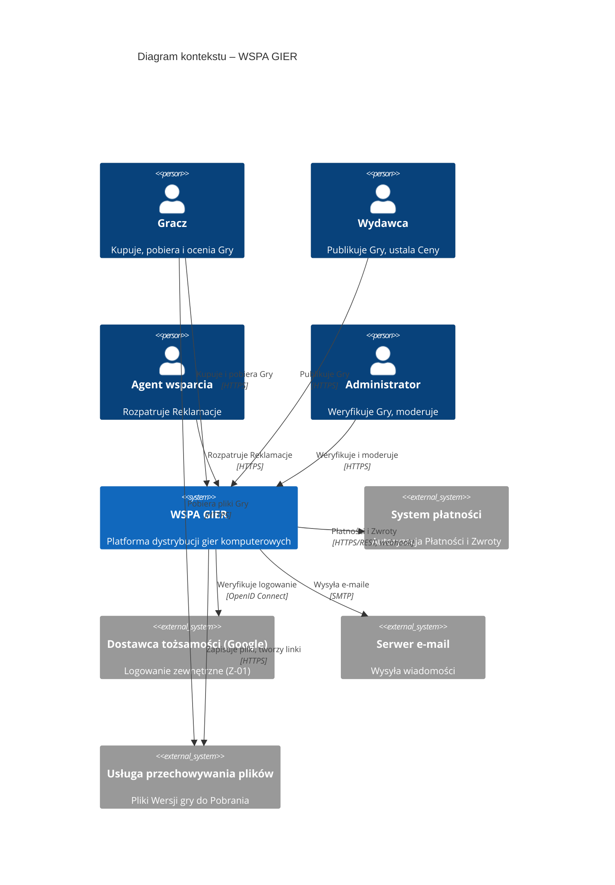

# 05. Architektura systemu

## 5.1. Styl architektoniczny i uzasadnienie

Do uzupełnienia w M3 (z ADR). Ograniczenie z sekcji 1.7: architektura klient-serwer z bazą danych.

## 5.2. Diagram kontekstu (C4, poziom 1)

### Systemy zewnętrzne

| System zewnętrzny | Co przekazujemy | Kierunek | Co przy awarii |
|---|---|---|---|
| System płatności | kwota, numer Zamówienia, adres powrotu; z powrotem wynik autoryzacji i potwierdzenie Zwrotu | WSPA GIER ↔ System płatności | Zamówienie zostaje w statusie NOWE, Gracz widzi komunikat i może ponowić Płatność; po 30 min Zamówienie jest ANULOWANE (RB-09). Zlecenia Zwrotu są ponawiane automatycznie. |
| Dostawca tożsamości (Google) | żądanie logowania; z powrotem potwierdzony adres e-mail i identyfikator konta Google | WSPA GIER ↔ Google | Logowanie zewnętrzne jest niedostępne, Gracz widzi komunikat i loguje się e-mailem i hasłem (RYZ-09). |
| Serwer e-mail | adres e-mail, temat i treść wiadomości | WSPA GIER → e-mail | Wiadomości trafiają do kolejki i są wysyłane ponownie co 15 min przez 24 h; zakup i Reklamacja działają dalej. |
| Usługa przechowywania plików | pliki Wersji gry od Wydawcy; do Gracza czasowy link do Pobrania | WSPA GIER ↔ usługa plików, Gracz ← usługa plików | Pobieranie i wgrywanie Wersji gry są niedostępne, Gracz widzi komunikat „Pobieranie chwilowo niedostępne”; Katalog gier i zakup działają dalej. |

## 5.3. Diagram kontenerów (C4, poziom 2)

Do uzupełnienia w M3.

## 5.4. Komponenty (C4, poziom 3) – dla backendu

Do uzupełnienia w M3.

## 5.5. Projekt API

Do uzupełnienia w M3.

## 5.6. Stos technologiczny (propozycja dla cz. 2)

Do uzupełnienia w M3.

## 5.7. Decyzje architektoniczne

Lista ADR w katalogu [adr/](adr/):

| ADR | Tytuł | Status |
|---|---|---|
| [ADR-0000](adr/0000-wzor-adr.md) | Wzór (nie usuwać, kopiować) | wzór |
